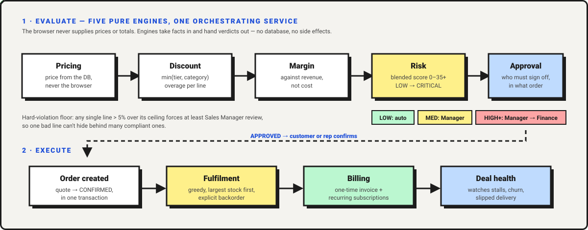
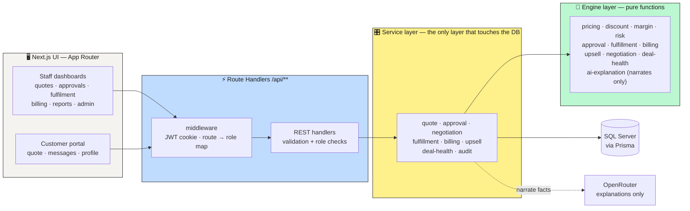
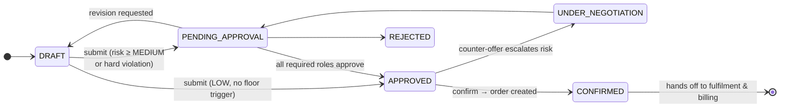
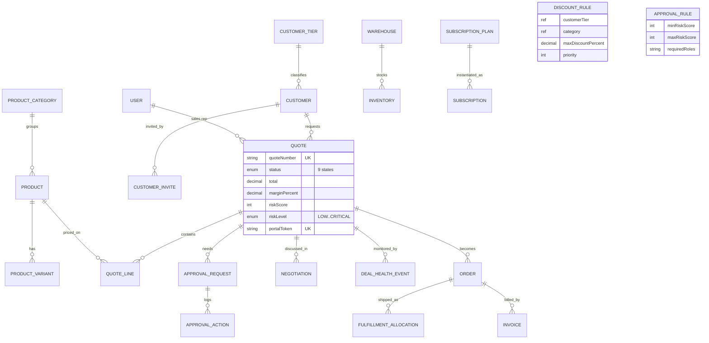

<div align="center">


<br/>

[](#-tech-stack)
[](#-tech-stack)
[](#-data-model)
[](#-data-model)
[](#-the-engine-layer)
[](#-security--access-control)
[](#-the-ai-layer-explains-never-decides)
[](#-team)

**A B2B quoting platform where every price, discount ceiling, risk score and approval route is computed by testable pure functions on the server — and the AI's only job is to explain what the engines already decided.**

</div>

---

## What is DealFlow360?

DealFlow360 is a **deal and quotation management system** for B2B sales teams. It replaces spreadsheets and fragmented quoting tools with one governed pipeline that runs from the first draft quote to the final invoice:

1. **Build a quote** with multiple products and variants, priced entirely server-side.
2. **Get instant guardrails** — discount ceilings, margin, a blended risk score and a live approval route as the quote is edited.
3. **Route approvals automatically** — nothing, a Sales Manager, or Sales Manager then Finance, depending on risk.
4. **Negotiate with the customer** in a dedicated portal, where every counter-offer re-runs the *exact same* pipeline.
5. **Confirm into an order**, allocate stock across warehouses, and generate invoices and subscriptions.
6. **Watch deal health over time** — stalls, slow approvals, negotiation churn and slipped deliveries are flagged before a deal quietly dies.
7. **Report and export** — analytics dashboards plus PDF and Excel exports.

It was built by **Team 488** for a hackathon, with the brief judged on *correct business rules* more than surface polish — which is why the logic lives in a documented engine layer rather than scattered across handlers.

<br/>

<div align="center">

<sub>Animated in a browser (GitHub renders raw SVG natively) — packets flow through the five evaluation engines, then into execution after approval.</sub>
</div>

---

## Table of Contents

- [Why This Exists](#why-this-exists)
- [Architecture at a Glance](#-architecture-at-a-glance)
- [The Engine Layer](#-the-engine-layer)
- [Risk & Approval Routing](#-risk--approval-routing)
- [Quote Lifecycle](#-quote-lifecycle)
- [Negotiation & the Customer Portal](#-negotiation--the-customer-portal)
- [Fulfilment & Billing](#-fulfilment--billing)
- [Deal Health](#-deal-health)
- [The AI Layer: Explains, Never Decides](#-the-ai-layer-explains-never-decides)
- [Roles & Access](#-roles--access)
- [Security & Access Control](#-security--access-control)
- [Data Model](#-data-model)
- [API Surface](#-api-surface)
- [Tech Stack](#-tech-stack)
- [Getting Started](#-getting-started)
- [Configuration Reference](#-configuration-reference)
- [Project Layout](#-project-layout)
- [Roadmap](#-roadmap)
- [Project Snapshot](#-project-snapshot)
- [Team](#-team)

---

## Why This Exists

B2B deal desks fail in familiar ways: a rep quietly gives 25% off a service line, the margin collapses, nobody notices until finance reviews the month, and the customer's "just one small change" restarts the whole approval chain by email. DealFlow360 is built around four ideas:

- **The browser is never trusted for money.** Clients may suggest a quantity and a discount percentage — unit prices and totals are recomputed from product records on the server every time.
- **Rules are explicit and explainable.** Ceilings, scores, bands and routes are named constants with worked examples, so any number on screen can be traced to a rule.
- **One pipeline for everyone.** An internal quote and a customer counter-offer go through the same engines. There is no simplified "portal version" of the maths.
- **AI is a narrator, not a judge.** It never changes a number; if it fails, a deterministic sentence builder takes over.

---

## 🏗 Architecture at a Glance

The layering is deliberately strict: **the engine decides, the service orchestrates, the database persists.**



| Layer | Allowed to | Never allowed to |
|---|---|---|
| **Engine** (`lib/engines/`) | Take facts, return a structured verdict | Read the database, call another engine's internals, send notifications, call an AI model |
| **Service** (`lib/services/`) | Fetch data, call engines in sequence, persist results, write audit logs | Contain business maths |
| **Route handler** (`app/api/`) | Authenticate, authorise, validate input, return JSON | Skip the service layer |

Because engines are pure, each one can be unit-tested with plain numbers — no server, no database.

---

## 🧮 The Engine Layer

Eleven engines, each documented in-file with its formula, thresholds and **worked examples**. Ten are pure functions; the AI explanation engine is the one exception, and it can only narrate.

| Engine | Decides |
|---|---|
| **Pricing** | Line subtotal from the product record — the client never supplies a price |
| **Discount** | Allowed ceiling per line = the **smaller** of the customer-tier ceiling and the product-category ceiling ("most restrictive wins"); records overage per line, never just the worst one |
| **Margin** | Line and quote margin, always expressed against **revenue** (not cost) |
| **Risk** | A blended, revenue-weighted score and a risk level |
| **Approval** | Which roles must sign off, and in what order |
| **Fulfilment** | Warehouse allocation by a transparent greedy heuristic |
| **Billing** | One-time vs recurring split, billing schedules, proration |
| **Upsell** | Ranked "customers who bought X also bought Y" suggestions |
| **Negotiation** | Re-evaluation of a counter-offer through the full pipeline |
| **Deal Health** | Over-time health of a deal, distinct from per-quote risk |
| **AI Explanation** | Plain-English narration of already-computed facts |

A few of the design choices worth knowing:

- **Blended, not worst-case, discount risk.** Overage is weighted by each line's share of revenue, so five lines each 3% over are scored on the whole deal rather than collapsed to a single worst line.
- **Margin is a ratio of revenue.** Dividing by cost would give *markup* — a different number a sharp reviewer would catch.
- **Fulfilment is greedy on purpose.** Largest stock first minimises shipments; any shortfall becomes an **explicit backorder**. Two hard invariants are enforced: total allocated never exceeds the request, and no warehouse is ever asked for more than it holds — manual overrides are validated against the same rules.

---

## ⚖️ Risk & Approval Routing

**Risk score** is additive and documented:

| Component | Points |
|---|---|
| Blended discount violation | Σ (line overage % × line's share of revenue) |
| Quote margin below the 15% floor | **+10** |
| Fulfilment needs 2+ warehouses | **+15** |
| Cannot be fully fulfilled | **+25** |

| Score | Level | Approval route |
|---|---|---|
| 0 – 9 | 🟢 **LOW** | None — straight to *Approved* |
| 10 – 19 | 🟡 **MEDIUM** | Sales Manager |
| 20 – 34 | 🟠 **HIGH** | Sales Manager → Finance (sequential) |
| 35+ | 🔴 **CRITICAL** | Sales Manager → Finance (sequential) |

**The dilution loophole is closed.** A blended score can be diluted by many compliant lines, so any single line more than **5%** over its ceiling forces *at least* Sales Manager review, even if the blended score says LOW. The approval output records which lines triggered the floor, for explainability.

**Re-approval never mutates history.** If an approved quote is re-evaluated and now needs a *different or higher* approval, a **new** approval request is created — old requests and their actions stay as they were.

---

## 🔄 Quote Lifecycle



The schema also reserves `FULFILLING`, `COMPLETED` and `CANCELLED` for the later stages of a deal. Sequential approvals are modelled as **steps**: only the first step is `PENDING`; later steps wait (`WAITING`) until the earlier reviewer acts. Every transition writes to an audit log with the actor, before/after state and timestamp.

---

## 🤝 Negotiation & the Customer Portal

Customers are **invited**, not self-registered: staff generate an invite link for a customer, the customer lands on `/onboard/{token}`, sets a password, and gets a portal account tied to their company. Invite tokens are **stored hashed**, expire, and have a status (`PENDING`, `ACCEPTED`, `EXPIRED`, `REVOKED`).

In the portal a customer can review a quote, **counter-offer**, accept it, and manage their profile.

- **Same pipeline, no shortcuts.** A counter-offer runs through pricing → discount → margin → risk → approval exactly like an internal edit. A quote that was auto-approved can come back requiring Finance if the counter pushes it over the line.
- **Negotiable states** are `DRAFT`, `PENDING_APPROVAL` and `UNDER_NEGOTIATION`; anything confirmed or cancelled is refused.
- **Restricted by shape, not by CSS.** The portal's API response deliberately omits margin, internal risk scores, approval reasoning and warehouse data — verifiable in the browser's network tab, not merely hidden in the UI.

---

## 📦 Fulfilment & Billing

**On confirmation**, a quote becomes an **order** in a single database transaction (quote → `CONFIRMED`, order created), then:

- **Allocation** — the fulfilment engine splits each product across warehouses by available stock; shipping cost is a flat per-warehouse figure; anything left over is an explicit backorder. Bulk allocation and manual override endpoints exist, with the override validated against stock.
- **Billing** — lines are split by `billingType`:
  - `ONE_TIME` lines sum into a single invoice for the order.
  - `RECURRING` lines each spawn a **subscription** and a billing schedule.
- **Invoice lifecycle** — `DRAFT → ISSUED → PAID`, with `CANCELLED` as a side exit; recording a payment flips an issued invoice to paid. Credit notes are modelled.
- **Proration** — mid-cycle quantity or plan changes charge or credit the difference:

  `daily rate = plan price ÷ days in period` → `prorated amount = daily rate × days remaining × quantity change`

  e.g. a ₹300/month plan, changed on day 10 (20 days left) from 2 to 3 seats → ₹10 × 20 × 1 = **₹200**; the reverse produces a ₹200 credit.

---

## 🩺 Deal Health

The risk engine asks *"does this submission need approval right now?"* Deal Health asks a different question — *"is this deal, over time, showing signs of dying?"* Reusing one score for both would label every big approved deal as risky forever, so they are separate engines.

| Signal | Points |
|---|---|
| **Stall** — each 7 days of inactivity | +5 (max +20) |
| **Discount anomaly** — more than 10pp above the rep's own average | +8 |
| **Approval delay** — any approval pending over 24h | +10 |
| **Delivery** — multi-warehouse / slipped delivery date | +10 / +15 |
| **Negotiation churn** — each counter after the 3rd | +5 (max +20) |

Bands: **0–9 Healthy · 10–19 Watch · 20–34 At risk · 35+ Critical**. Events are stored with their reasons and can raise alerts.

---

## 🤖 The AI Layer: Explains, Never Decides

The AI Explanation engine sits **on top of** every other engine and is built last:

- It receives **already-computed, structured reasons** (risk components, approval roles, deal-health signals) and turns them into natural language.
- It **never** changes a score, a route or a price. If someone asks *"why did the AI require Finance approval?"*, the honest answer is: it didn't — the Approval engine did, deterministically, before the AI was called.
- It **can't be a single point of failure.** If the model call errors, times out or returns malformed output, a deterministic sentence builder produces the explanation from the same reasons list — the feature works with **zero model calls**.
- Explanations are served by `POST /api/ai/explain`, which calls an OpenRouter-hosted model configured by environment variable.

The upsell engine follows the same transparency principle: suggestions are framed as *"customers who bought X also bought Y"* with a plain reason string, and a **hard margin filter** runs before ranking — a very popular add-on is never suggested if it sits below the 15% margin floor.

---

## 👥 Roles & Access

| Role | Typical use | Main areas |
|---|---|---|
| **ADMIN** | Configure rules and catalogue | Everything, plus `/admin`: discount rules, upsell rules, approval rules, warehouses |
| **SALES_REP** | Build and negotiate quotes | Quotations, products, customers, subscriptions, deal health |
| **SALES_MANAGER** | First-line approver | Approvals, fulfilment, invoices, reports |
| **FINANCE** | Second-line approver and billing | Approvals, invoices, subscriptions, reports |
| **OPERATIONS** | Warehouse and delivery | Fulfilment, products, quotations (read) |
| **CUSTOMER** | Portal user | `/portal` only — their own quote, messages, profile |

---

## 🔐 Security & Access Control

- **Sessions** are signed **JWTs** (verified in middleware with `jose`) held in an HTTP session cookie.
- **Route-to-role map** — a central table decides which roles may open each page and API prefix; handlers additionally check the session role before doing any work.
- **Passwords** are hashed with **bcrypt**; invite tokens are hashed before storage.
- **Login rate limiting** — 5 attempts per 15-minute window per key.
- **Server-side pricing** — quantities and discount requests are accepted from the client; prices and totals never are.
- **Restricted portal responses** — customer-facing payloads are a separate, allow-listed shape.
- **Audit trail** — quote creation, edits, evaluations, negotiations and confirmations are written to an audit log with actor and before/after snapshots.

---

## 🗄 Data Model



Around the core: `price_lists`, `discount_rules`, `approval_rules`, `upsell_rules`, `product_co_purchases`, `billing_schedules`, `payments`, `credit_notes`, `negotiation_messages`, `alerts`, `audit_logs` and `notifications`. Money columns are fixed-precision decimals; timestamps use `DateTime2`. Three Prisma migrations ship in the repo (init, customer invites, product variants).

---

## 🔌 API Surface

| Area | Routes |
|---|---|
| **Auth** | `POST /auth/login` · `/register` · `/logout` · `GET /auth/me` |
| **Quotes** | `GET/POST /quotes` · `GET/PATCH /quotes/{id}` · `POST …/evaluate` · `…/submit` · `…/negotiate` · `…/confirm` · `…/upsell` · `GET …/audit` |
| **Approvals** | `GET /approvals` · `GET/PATCH /approvals/{id}` |
| **Catalogue** | `/products` (+ `/bulk`, `/{id}`, `/{id}/variants[/{variantId}]`) · `/price-lists` |
| **Customers** | `GET/POST /customers` · `…/{id}/invite` · `…/{id}/discount-ceiling` |
| **Orders & fulfilment** | `/orders` · `/orders/{id}` · `…/fulfillment/override` · `/fulfillment` · `…/bulk-allocate` |
| **Warehouses** | `/warehouses` · `/warehouses/{id}` · `…/inventory` |
| **Billing** | `/invoices` (+ `/bulk`, `/{invoiceId}`) · `/billing` |
| **Subscriptions** | `/subscriptions` · `…/plans` · `…/{id}` · `…/{id}/cancel` |
| **Admin rules** | `/admin/discount-rules` · `/admin/upsell-rules` · `/admin/approval-rules` (each with `/{id}`) |
| **Deal health & AI** | `GET /deal-health` · `POST /ai/explain` |
| **Reports** | `/analytics` · `/reports/summary` · `/reports/export/pdf` · `/reports/export/xls` |
| **Portal** | `/portal/quote` · `/portal/profile` · `…/profile/password` · `POST /portal/quotes/{token}/confirm` |
| **Onboarding** | `GET/POST /onboard/{token}` |

---

## 🛠 Tech Stack

| Layer | Technology |
|---|---|
| **Framework** | Next.js 16 (App Router, Route Handlers, middleware) · React 19 · TypeScript |
| **Styling** | Tailwind CSS v4 · neo-brutalist design tokens (hard borders, offset shadows) |
| **Data fetching** | TanStack Query |
| **Database** | **Microsoft SQL Server** via Prisma 5 |
| **Auth** | `jose` (JWT) · bcryptjs |
| **Validation** | Zod |
| **Documents** | PDFKit · ExcelJS |
| **AI** | OpenRouter (configurable model) with a deterministic fallback |
| **Email** | Resend (invite emails) — console mock when no key is set |
| **Dev data** | `@faker-js/faker` seed and reset scripts |

---

## 🚀 Getting Started

**Prerequisites:** Node.js 20+, and a reachable **SQL Server** instance (local, Docker or Azure).

```bash
git clone https://github.com/jalisa2106/team-488-dealflow360.git
cd team-488-dealflow360/frontend

npm install
cp .env.example .env            # then fill in the values below

npx prisma generate
npx prisma migrate dev          # applies the three migrations
npm run db:seed                 # demo users per role, tiers, products, warehouses, quotes

npm run dev                     # http://localhost:3000
```

Useful scripts:

```bash
npm run db:reset          # wipe the database
npm run db:reset-seed     # wipe and reseed
npm run build             # production build
npm run lint
```

The seed creates demo accounts for **every role** (admin, sales rep, sales manager, finance, operations) plus customers across all three tiers, so each dashboard has data on first login — see `prisma/seed.ts` for the demo credentials.

---

## 🔧 Configuration Reference

| Variable | Purpose |
|---|---|
| `DATABASE_URL` | SQL Server connection string (Prisma `sqlserver` format) |
| `JWT_SECRET` | **Required.** Signs session tokens; middleware throws if it's missing |
| `SESSION_COOKIE_NAME` | Session cookie name (default `dealflow360_session`) |
| `NEXT_PUBLIC_APP_URL` | Public base URL — used to build invite links |
| `OPENROUTER_API_KEY` | Enables AI explanations; without it the deterministic fallback is used |
| `OPENROUTER_MODEL` | Model identifier (a free model is the default) |
| `RESEND_API_KEY` | Sends real invite emails; without it the invite is printed to the server console |

---

## 📁 Project Layout

```
team-488-dealflow360/
├── frontend/
│   ├── prisma/
│   │   ├── schema.prisma            # SQL Server models
│   │   ├── migrations/              # init · customer invites · product variants
│   │   └── seed.ts · reset.ts
│   └── src/
│       ├── app/
│       │   ├── (auth)/login/
│       │   ├── (dashboard)/         # dashboard · quotations · approvals · fulfillment · orders
│       │   │                        # products · customers · invoices · subscriptions
│       │   │                        # deal-health · reports · analytics · admin/*
│       │   ├── portal/              # customer-facing: quotation · messages · profile
│       │   ├── onboard/[token]/     # invite acceptance
│       │   └── api/                 # Route Handlers
│       ├── lib/
│       │   ├── engines/             # 11 engines, each with worked examples
│       │   ├── services/            # orchestration + persistence + audit
│       │   ├── auth/                # jwt · session · rbac · hash · rate-limit · invite-token
│       │   ├── email/ · db/ · api/  # invites · Prisma client · fetch client
│       │   └── sku.ts · types.ts
│       ├── components/              # TopNav · Toolbar · Toast · providers
│       └── middleware.ts            # JWT check + route → role map
└── md-docs/
    ├── architecture.md · business-logic-explanations.md
    ├── dealflow360-engine-prompts.md · neo-brutalist-theme-guide.md · templates.md
```

---

## 🗺 Roadmap

- [x] Eleven documented engines with worked examples and enforced invariants
- [x] Quote → approval → negotiation → order → fulfilment → invoice pipeline
- [x] Customer invites, hashed tokens and a restricted customer portal
- [x] Admin-configurable discount, upsell and approval rules
- [x] Warehouse inventory, bulk allocation and validated manual overrides
- [x] Subscriptions with proration; PDF and Excel report exports
- [x] Deal-health monitoring and AI explanations with a no-model fallback
- [ ] Unit tests for the engines — they're pure functions with worked examples already written, so this is the cheapest high-value next step
- [ ] Move login rate-limiting from in-process memory to a shared store so it survives restarts and multiple instances
- [ ] Remove the `/api/debug` route and tighten which `/api` prefixes are publicly reachable in middleware
- [ ] Deliver invite emails with a verified sender domain instead of the sandbox sender
- [ ] Clean up leftover scratch files (`scratch.ts`, `test-quote-fetch.js`)

---

## 📦 Project Snapshot

<!--ARCHIVE_STATS_START-->
<!-- auto-generated by archive_stats.py — do not edit this block manually -->

### 📦 Project Snapshot &nbsp;·&nbsp; <sub>refreshed 15 Nov 2026, 01:14 PM IST</sub>

   

| 📅 Created | 🔄 Last Push | 💬 Total Commits | ⭐ Stars | 🍴 Forks | 📜 License |
|---|---|---|---|---|---|
| 2026-09-13 | 2026-11-08 | 42 | 0 | 0 | None |

**Live Demo:** [sp2736.github.io/team-488-dealflow360](https://sp2736.github.io/team-488-dealflow360) &nbsp; <sub>last deployed 2026-11-08</sub>

**Languages:** `TypeScript` 92.8%  `TSQL` 4.7%  `CSS` 2.3%  `JavaScript` 0.2%

**Top Contributors:** [@Sp2736](https://github.com/Sp2736) `22` · [@jalisa2106](https://github.com/jalisa2106) `15` · [@trupal286](https://github.com/trupal286) `5`

<!--ARCHIVE_STATS_END-->

---

## 👨‍💻 Team

Built by **Team 488** — a team of three covering frontend and portal, backend and database, and the business-logic engines.

The design documents behind the engines (architecture, the business-logic playbook, the engine specifications and the neo-brutalist theme guide) live in [`md-docs/`](./md-docs).

<div align="center">
<sub>The engine decides. The service orchestrates. The database persists.</sub>
</div>
